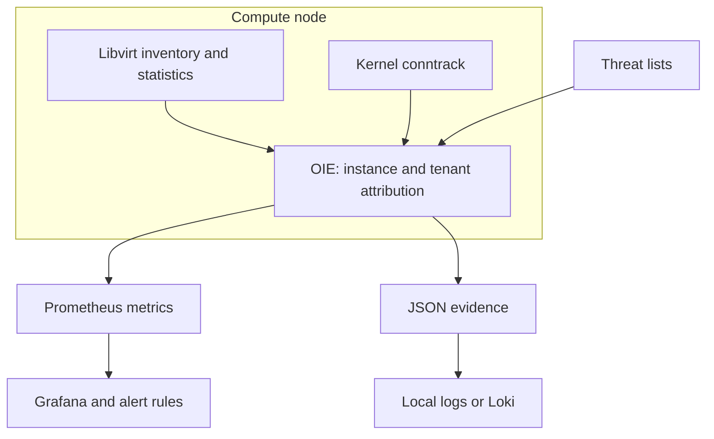

# OpenStack Instance Exporter (OIE)

**v2.0.0**

OIE is a hypervisor-side Prometheus exporter for KVM/OpenStack that turns host and instance activity into metrics: **libvirt + kernel conntrack + threat intel + behavior detection**.

It answers the questions behind host pressure and tenant activity:

- *What a VM is doing to shared host resources* (CPU, memory, disk, and the kernel’s conntrack budget).
- *What a VM is doing on the network* (fan-out, scanning patterns, anomalous behavior).

It does this **without an agent inside the tenant**, **without OpenStack API credentials** and **without packet capture**.

---

## Table of contents

1. [Logging](README.md#logging)
2. [What problem this solves](README.md#what-problem-this-solves)
3. [What gaps it fills](README.md#what-gaps-it-fills)
4. [Why it’s free and what that means](README.md#why-its-free-and-what-that-means)
5. [Executive value table](README.md#executive-value-table)
6. [Architecture](README.md#architecture)
7. [Data sources and why they matter](README.md#data-sources-and-why-they-matter)
8. [Zero agents, zero packet capture](README.md#zero-agents-zero-packet-capture)
9. [Identity model and label strategy](README.md#identity-model-and-label-strategy)
10. [Behavior detection and evidence](README.md#behavior-detection-and-evidence)
11. [Resource collection: measurements and freshness](README.md#resource-collection-measurements-and-freshness)
12. [Conntrack engine: shared blast radius](README.md#conntrack-engine-shared-blast-radius)
13. [Behavior engine: EWMA and heuristics](README.md#behavior-engine-ewma-and-heuristics)
14. [Threat intelligence engine](README.md#threat-intelligence-engine)
15. [Attached RBD volume retypes](README.md#attached-rbd-volume-retypes)
16. [Logging and evidence](README.md#logging-and-evidence)
17. [Tuning and configuration](README.md#tuning-and-configuration)
18. [nf_conntrack_acct: bytes/packets per flow](README.md#nf_conntrack_acct-bytespackets-per-flow)
19. [Cardinality, scaling, and TSDB safety](README.md#cardinality-scaling-and-tsdb-safety)
20. [Performance and overhead](README.md#performance-and-overhead)
21. [Operational workflows (runbooks)](README.md#operational-workflows-runbooks)
22. [Dashboards](README.md#dashboards)
23. [Alerting](README.md#alerting)
24. [Deployment](README.md#deployment)
25. [Compatibility](README.md#compatibility)
26. [Permissions and security model](README.md#permissions-and-security-model)
27. [Troubleshooting](README.md#troubleshooting)
28. [FAQ (blunt answers)](README.md#faq-blunt-answers)
29. [Development](README.md#development)
30. [Appendix A: Metric reference](README.md#appendix-a-metric-reference)
31. [Appendix B: Log schema and examples](README.md#appendix-b-log-schema-and-examples)
32. [Appendix C: Glossary](README.md#appendix-c-glossary)
33. [License](README.md#license)

## Logging

Collection diagnostics, behavior signals and threat evidence share one **JSON lines** stream. See [Logging and evidence](README.md#logging-and-evidence) for output options, throttling and Loki ingestion, and [Appendix B](README.md#appendix-b-log-schema-and-examples) for event fields and examples.

## What problem this solves

OpenStack gives you scheduling, quotas and API-level telemetry.
Operating the compute fleet also means answering questions like:

- Which tenant VM is filling the host conntrack table?
- Which VM is quietly scanning destinations or ports?
- Which project reserves much more CPU or RAM than its workloads use?
- Why is “the cloud slow” on this host right now: scheduler contention, disk latency or flow pressure?
- Is an instance contacting threat-listed infrastructure, or receiving connections from it?
- Why is an attached volume retype still waiting after its copy reaches 100%?

OIE fills that gap with **per-VM attribution** from the compute node’s own observations.
Instance, project and user identity stay with the data, so a host symptom can be followed to the workloads involved and their owners.

## What gaps it fills

OIE connects three views of the same workload:

- **Resources:** CPU, memory, storage and interface activity measured through Libvirt.
- **Network state:** connection-table consumption, direction, reply state, remote breadth and port concentration.
- **Ownership:** instance UUID, project and user identity from Nova metadata in Libvirt.

These views share instance and tenant identity, so resource consumption and network activity can be investigated together.

## Why it’s free and what that means

OIE is Apache-2.0 licensed.
That matters operationally:

- You can deploy it **one-per-compute** across a fleet without per-core licensing.
- You can embed it into your OpenStack deployment tooling.
- You can inspect, audit and tailor the detection rules and thresholds to your environment.
- You can keep metrics and event evidence in your own monitoring stack.

It is designed to be a visibility layer across the compute fleet.

## Executive value table

| Domain | Administrative challenge | Exporter capabilities | Operational value |
| --- | --- | --- | --- |
| Network behavior and threats | Identifying unusual tenant traffic and the workload behind it. | Fast/slow EWMA context, built-in classifications, custom rules and direction-aware threat-list matching. | Instance and ownership context, with reasons and endpoint evidence for investigation. |
| Operational stability | Finding workloads that occupy a shared connection table. | Host conntrack utilization and per-instance fixed-IP flow counts. | Connect host connection pressure to the workloads contributing to it. |
| Performance and troubleshooting | Explaining CPU contention, storage latency and packet impact on shared computes. | CPU usage and scheduler delay; per-disk latency, IOPS and throughput; NIC errors and drops. | Identify affected workloads and dominant consumers in the same time window. |
| Capacity and right-sizing | Relating reserved capacity to actual workload use. | Allocated vCPUs and memory beside consumption, grouped by project and user. | Evidence for capacity reviews and right-sizing discussions. |
| Volume operations | Following an attached RBD copy and its effect on a running VM. | Observed block-copy presence, progress and copy-ready state beside workload I/O. | Distinguish copying from waiting for pivot and correlate the operation with VM performance. |
| Monitoring operations | Keeping detailed evidence without multiplying destination labels. | Summarized Prometheus metrics, bounded behavior state and JSON event logs. | Fleet dashboards and detailed evidence in the same monitoring stack. |

## Architecture

OIE runs on the **compute node** and collects:

- **Libvirt domain inventory and statistics:** CPU, memory, disks, NICs, state and Nova ownership metadata.
- **Kernel conntrack:** IPv4/IPv6 connection state, fixed-IP attribution and OVN zone ownership where available.
- **Threat lists:** public feed snapshots and local custom address lists.
- **Behavior features:** fast/slow EWMA context and heuristic classifications per instance, fixed IP and direction.
- **Optional attached RBD copies:** Libvirt block-job observations for volume retypes.

### Dataflow diagram



Collection runs in the background, independently of Prometheus scrapes. Prometheus stores history; Grafana provides fleet, compute, project and instance views. JSON logs carry the detailed network evidence.

OIE does not query OpenStack APIs and needs no separate telemetry database or message bus.

## Data sources and why they matter

### Libvirt: the VM’s resource truth

Libvirt tells you:

- Which domains exist and are active.
- CPU time, vCPU allocation and host-scheduler delay.
- Guest memory usage signals, process RSS, faults and swap where available.
- Disk service time, request counters and bytes transferred.
- NIC byte/packet counters and errors/drops.
- OpenStack identity from Nova’s domain metadata.
- Attached RBD block-copy state when retype monitoring is enabled.

This is what lets OIE attribute **host-side resource observations** to **tenant instances**, without guest agents or cloud API lookups.

### Configured inventory and active measurements

Inventory metrics include inactive Libvirt definitions, configured disks, interfaces, block devices and fixed addresses. This preserves the instance and device context when a workload is stopped or has no runtime statistics.

Inventory describes configuration. A configured address does not prove live network ownership or current Neutron state; a configured disk does not establish runtime or physical storage consumption. Active measurements and their source/freshness state remain separate.

### Conntrack: the VM’s network state truth

Conntrack tells you:

- How many flows exist.
- Direction: the VM as original source or destination.
- Whether replies have been seen.
- Optional bytes and packets per flow when `nf_conntrack_acct=1`.
- The conntrack zone, when present, for mapping flows into the correct tenant context.

This is what lets OIE attribute:

- **Host conntrack consumption**, a shared resource that bandwidth alone does not explain.
- **Scanning and fan-out patterns** from connection state.
- **Overlapping tenant addresses**, when a fresh and reliable zone/port mapping is available.

Resource collection works without conntrack. Connection-state attribution, behavior and per-instance feed matching depend on the kernel observations.

### Threat intel: listed infrastructure touchpoints

Threat lists tell you:

- Whether remote addresses in observed flows are present in an enabled list.
- Contact activity over time.
- The active-flow population matching that list now.

The meaning depends on the list: a Tor entry identifies Tor infrastructure, while a custom list can represent your own watchlist.

## Zero agents, zero packet capture

### What OIE does not do (by design)

- No agent inside tenant VMs.
- No OpenStack API credential requirement.
- No packet capture or TCP stream reassembly.
- No signature scanning over application payloads.
- No per-flow Prometheus time series.

Guest processes and payloads are outside OIE’s visibility. Encrypted application traffic still has observable connection state where the dataplane exposes it, but OIE cannot identify its contents.

## Identity model and label strategy

OIE uses identity labels because you cannot operate a cloud without ownership.
Metrics without identity create endless “who owns this?” churn.

### Standard label sets (practical)

- **Instance base metrics:** `domain, server_name, instance_uuid, project_uuid, project_name, user_uuid`.
- **Instance metadata (`oie_instance_info`):** base labels plus `user_name, flavor, vcpus, mem_mib, root_type, created_at, metadata_version`.
- **Instance state:** base labels plus `state_desc`.
- **Configured inventory:** instance identity and configured domain/device/address metadata, including inactive definitions.
- **Conntrack and behavior features:** base labels plus local `ip, family`; inbound and outbound feature families are separate.
- **Disk metrics:** base labels plus `volume_uuid, disk_type, disk_path`.
- **NIC metrics:** base labels plus `ifname`.
- **Per-vCPU scheduler counters:** base labels plus `vcpu`.
- **Resource freshness:** base labels plus `axis`.
- **Threat contacts and active flows:** base labels plus `direction`, with separate families per list.
- **Mining candidates:** local IP/family, port/name and port-confidence labels alongside instance identity.
- **Retype observations:** disk identity plus `destination_volume_uuid, destination_disk_type`.

The historical `volume_uuid` label identifies the Libvirt storage source. Depending on the backend, it can be a volume UUID, image name or local device/file path; it is not always a Cinder UUID. Configured disk inventory also includes roles such as CD-ROM, config drive and swap; inventory-only devices do not imply performance measurements.

The [metric schema](testdata/contracts/metric-schema.txt) gives the exact ordered labels for every exported OIE family.

### Why IDs and names together

- UUIDs are stable keys for automation and incident response.
- Names are human-friendly for dashboards and investigation.
- Both let operators move quickly without a separate ownership lookup.

### Why fixed IP mapping is the right bridge

Conntrack is keyed by IPs and ports.
By attributing flows to fixed IPs owned by a VM:

- You can identify instances contributing to connection pressure.
- You can split inbound and outbound activity.
- You can scope observations to the instance’s local addresses.

Fresh OVN zone/port ownership supplies the context needed when several tenants use the same IP address. Without reliable zone context, a uniquely owned local IP can provide a fallback. Ambiguous ownership is unavailable rather than assigned to a guessed tenant.

### Cardinality rules (non-negotiable)

Identity labels preserve ownership without adding a series for every remote endpoint. [Cardinality, scaling, and TSDB safety](README.md#cardinality-scaling-and-tsdb-safety) describes the series model and where detailed evidence belongs.

## Behavior detection and evidence

### Behavior signals: human-readable evidence

Behavior events explain the classification with a reason, workload identity, observed features and representative endpoint evidence. Stable evidence keys make the JSON suitable for parsers as well as investigation; [Appendix B](README.md#appendix-b-log-schema-and-examples) defines their scope, missing values and remote-tracking limits.

### Port naming (built-in map + optional config file)

The exporter ships with a **built-in port → name** map for common services (ssh/http/https/rdp/mysql/redis/etc) so alerts and dashboards are readable out of the box.

If you want to provide your own named “known good” ports for **dark-space detection**, you can supply a YAML file via:

- `--behavior.ports_config=/etc/oie/behavior_ports.yaml`

YAML schema (ports are numeric keys; values are required human-readable names):

```yaml
behavior:
  ports:
    inbound_monitored:
      22: ssh
      3389: rdp
      6443: kube-api
    outbound_monitored:
      25: smtp
      465: smtps
      587: submission
      8333: bitcoin_p2p
```

**Notes**

- The built-in maps are used by default.
- If `inbound_monitored` is present in the file, it **replaces** the built-in inbound map.
- If `outbound_monitored` is present in the file, it **replaces** the built-in outbound map.
- If only one direction is provided, that direction comes from the file and the other direction stays on the built-in map.
- Port names must be non-empty strings; empty names are rejected as invalid config.
- Without a configured file, OIE uses the built-in maps. A configured file must exist and pass validation; a missing, empty or invalid file stops startup.
- This file is read at startup (restart the exporter to apply changes).

### Rule evaluation order and precedence

Built-in classifications take precedence over external rules. The built-in detector has an explicit order for restricted/local traffic, combined dark-space signals, protocol patterns, scans, exposure and capacity/flood conditions. It can combine related observations into one signal.

External rules are checked in YAML order only when no built-in generic classification applies; the first matching external rule wins. They add environment-specific detections rather than replacing built-ins. Mining has its own persisted classification lifecycle.

### External behavior rules (optional)

If you need environment-specific detections, provide a YAML file through `--behavior.rules_config=/etc/oie/behavior_rules.yaml`.

```yaml
port_sets:
  custom_service: [19000, 19001]
  admin: [22, 3389, 2375, 6443]

rules:
  - id: outbound_custom_service_fanout
    signal: outbound_custom_service_fanout
    direction: outbound
    port_set: custom_service
    flows_min: 200
    unique_remotes_min: 50
    ratios:
      unreplied: 0.80

  - id: inbound_admin_fanout
    signal: inbound_admin_fanout
    direction: inbound
    port_set: admin
    flows_min: 50
    unique_remotes_min: 10
```

**Notes**

- `id` and `signal` are required. Direction is `inbound`, `outbound` or `any`.
- Port-set rules evaluate the flows and remote/reply evidence for their selected ports.
- Custom thresholds are evaluated as configured; `--behavior.sensitivity` does not rescale them.
- Configured rules must pass validation; missing, empty or invalid files stop startup. Custom configuration files also load at startup.
- External rules emit behavior events. They do not automatically create Prometheus alert rules.
- The built-in mining signal is reserved for its own lifecycle.

### Persistence gate and cooldown

To reduce repeated notices and transient detections:

- Signals need consecutive qualifying, complete collection observations and a minimum elapsed time.
- Repeated scrapes of the same snapshot do not advance persistence.
- Changed signals or dominant endpoints can produce a new event; unchanged activity is subject to cooldown and heartbeat rules.
- Collection failures do not establish a clean observation or advance detection persistence.

The event explains the signal and evidence. Prometheus notification policy is configured separately in [Alerting](README.md#alerting).

## Resource collection: measurements and freshness

The resource collector answers:

- “What is this VM consuming?”
- “Is it waiting for CPU or seeing storage/network impact?”
- “Is the observation current, retained or unavailable?”

### Resource axes

- **CPU:** live-vCPU-normalized usage and per-vCPU scheduler counters.
- **Memory:** allocation, guest-view usage, QEMU RSS, swap and faults where available.
- **Disk:** per-device read/write/flush rates, bytes and interval-mean latency.
- **Network:** interface bytes, packets, errors and drops.

These observations remain separate so a CPU problem, storage problem and connection-state problem can be investigated on their own measurements.

### Fresh, last-good and unavailable

Source health is part of the data. OIE can retain last-good measurements through temporary failures instead of converting missing observations to zero.

For each resource axis:

- `oie_instance_resource_axis_fresh` is `1` when the current cycle has a complete valid sample.
- `oie_instance_resource_axis_available` is `1` for a fresh or retained sample within its retention age.
- `oie_instance_resource_axis_last_success_timestamp_seconds` identifies the last complete sample.
- `oie_instance_resource_axis_stale_seconds` gives its age, or `-1` before the first success.

Axis availability expires after eight collection intervals without a complete sample. Cached raw values can remain visible during a Libvirt outage, so judge them through availability, freshness and age. Authoritative changes in instance/device identity also matter: an old sample must not be treated as belonging to a replacement device or workload.

### Collection during compute operations

OIE uses nonblocking Libvirt statistics and defers monitor-dependent observations when domain jobs make them unsafe to query. Active block jobs defer disk statistics while CPU, memory and interface statistics can continue. Migration, backup and other busy domain operations can cause broader observation gaps. Source-health and per-axis freshness show those gaps; they do not establish zero workload activity.

**Missing or stale data must not be read as healthy zeroes.** A working HTTP endpoint means the exporter is serving; it does not prove every source is healthy.

### Measurement semantics

- CPU usage is normalized by live vCPUs.
- CPU steal and wait are alternative host-scheduler waiting counters, not guest I/O wait; do not add them as independent CPU impact.
- Guest-used memory requires usable balloon statistics. OIE omits it when they are unavailable rather than substituting QEMU RSS.
- Guest usage and QEMU RSS are different measurements. RSS is not unique physical host RAM consumption, allocated-minus-used is not exact reclaimable host RAM, and guest swap alone does not prove shared-host pressure.
- Disk latency is an interval mean, not a tail-latency percentile.
- Disk allocation is Libvirt’s highest-written-sector boundary, not physical Ceph/backend consumption.
- Units named `_mib` and `_gib` use MiB and GiB; `s/s` means seconds per second.
- QEMU process changes and device replacement reset rate baselines, preventing a new workload or device from inheriting old counters.

The [metric schema](testdata/contracts/metric-schema.txt) and HELP/TYPE descriptions at `/metrics` define the public measurements.

## Conntrack engine: shared blast radius

Conntrack is a host-wide table.
A large flow population from one workload can consume shared state and affect connections beyond that workload.

Host conntrack metrics:

- `oie_host_conntrack_entries`.
- `oie_host_conntrack_max`.
- `oie_host_conntrack_utilization`.

Per-instance flow attribution:

- `oie_instance_conntrack_ip_flows`.
- `oie_instance_conntrack_ip_flows_inbound`.
- `oie_instance_conntrack_ip_flows_outbound`.

A flow between two local instances can contribute to both instances’ counts. Their sums are not a disjoint breakdown of the host table.

### Why conntrack matters

- It reflects kernel state consumption, not just bandwidth.
- Scans, idle connections and small flows can occupy many entries with modest throughput.
- Connection-table pressure can appear as intermittent timeouts across workloads.

### How to operate with conntrack

The [conntrack runbook](README.md#conntrack-saturation-before-it-becomes-an-outage) follows table pressure into workload attribution and endpoint evidence. Observed direction identifies the initiating side of a flow; it does not by itself establish abuse or an attack.

### Mitigation levers (real cloud ops)

The instance and project identity provide a handoff for your normal operational process:

- Neutron security-group restrictions.
- Workload isolation or quarantine.
- Edge ACLs and rate limits.
- Capacity changes after evaluating the kernel memory cost.

The measurements inform those decisions; OIE does not automatically change cloud networking or instance policy.

### OVN, conntrack zones, and dataplane compatibility

OIE’s attribution is designed around a hard reality: **tenant IP overlap is normal**.

In OVN deployments, conntrack zones and logical-port ownership can supply the context that separates tenants using the same fixed IP. OIE combines a fresh zone/port mapping with the local instance inventory.

#### OVN / OVN+OVS

- Fresh, reliable zone/port ownership allows overlapping addresses to be distinguished.
- Mapping health and freshness remain part of attribution quality.
- A stale or ambiguous mapping must not be treated as a confirmed tenant identity.

#### Linux Bridge / OVS without usable zones

OIE can still expose:

- Host conntrack utilization and reader health.
- Per-instance attribution for uniquely owned local fixed IPs.
- Behavior features for observations with reliable ownership.

Overlapping tenant addresses without reliable zone context are ambiguous. If an enabled address family contains unresolved overlap, OIE degrades conntrack collection and retains its last complete snapshot where valid. It does not publish a fresh snapshot with guessed owners or only the conveniently attributable flows.

Offload and asymmetric routing can limit network visibility. The table reflects the state visible to this compute, not a complete capture of every packet path.

### Raw conntrack reader

OIE uses a purpose-built raw reader over Netlink, parsing kernel messages into a compact in-memory representation.

- Raw is the conntrack backend; there is no alternative reader fallback.
- IPv4 and IPv6 reads are enabled by default.
- A fresh snapshot requires complete reads of every enabled address family. A failed or partial dump retains the last complete snapshot where valid; OIE does not combine partial data into a fresh view or advance behavior/threat detection from it. Health and freshness metrics expose the gap.
- Both families can be disabled with `--conntrack.ipv4.enable=false --conntrack.ipv6.enable=false` for resource collection without conntrack reads.

### Raw conntrack reader health metrics

- `oie_host_conntrack_raw_ok`: whether the last raw read succeeded.
- `oie_host_conntrack_raw_enobufs_total`: receive-buffer exhaustion events.
- `oie_host_conntrack_raw_parse_errors_total`: parse errors.
- `oie_host_conntrack_last_success_timestamp_seconds`: last successful read.
- `oie_host_conntrack_stale_seconds`: age since success, or `-1` before the first success.
- `oie_host_conntrack_read_duration_seconds`: time spent reading the table.
- `oie_host_conntrack_read_errors_total`: read errors.

These metrics are host-level instrumentation; they do not add per-flow labels.

### Raw reader socket buffer sizing

`--conntrack.raw.rcvbuf_bytes` requests the raw Netlink socket’s receive buffer. The default is **33554432 bytes (32 MiB)**. `--conntrack.raw.rcv_timeout` defaults to **15s**.

If reads encounter ENOBUFS, review the requested receive buffer and the kernel limit `net.core.rmem_max`. Raising the request above the kernel cap will not deliver the intended buffer. OIE does not change the host limit itself.

Size this from observed read health and collection duration on the compute; table size alone does not establish a guaranteed buffer requirement.

## Behavior engine: EWMA and heuristics

Behavior engine answers:

- “Is this VM’s network behavior normal for itself?”
- “Is it suddenly scanning, fanning out, or receiving a spray of inbound probes?”
- “Is it showing service-specific patterns worth investigating?” (SMTP fan-out, mining-pool candidates, admin-port exposure, etc.)

### Key properties

- Identity: *(instance UUID, fixed IP, direction)*.
- Inputs: conntrack snapshot-derived features (flows, ports, remotes, unreplied, optional acct bytes/packets).
- Method: fast/slow EWMA + heuristic classification.
- Output: feature metrics, classifications and structured logs with evidence.

### Behavior signals: EWMA and heuristics

The detector emits a `signal` when classification and lifecycle gates pass. Signals are operator-readable and carry reasons and observed features.

Examples include:

- **Vertical port scans:** many destination ports concentrated on a remote, with reply-state evidence.
- **Horizontal scans and fan-out:** many remotes or a widening service footprint.
- **Focused floods:** traffic concentrated on an endpoint or service.
- **Dark-space activity:** qualifying traffic outside the configured monitored-port maps.
- **Admin-port exposure:** inbound activity on sensitive administration services.
- **SMTP fan-out:** outbound mail-port activity with substantial remote breadth.
- **DNS/UDP patterns:** protocol-scoped volume and reply evidence; accounting-dependent checks also need bytes/packets.
- **Restricted infrastructure traffic:** probes of local/control-plane addresses and services.
- **Mining-pool candidates:** persisted outbound connections meeting the mining detector’s port, reply and persistence conditions.

A classification describes observed network state. It does not inspect the guest process or application payload.

### Why fast+slow EWMA matters

The fast average follows recent activity; the slow average provides longer-term context for the same instance, fixed IP and direction. Some classifications use their relationship alongside traffic shape and thresholds, so a busy workload and a quiet workload can be assessed against their own history.

### Behavior feature metrics (exported)

Inbound:

- `oie_instance_inbound_flows`
- `oie_instance_inbound_unique_remotes`
- `oie_instance_inbound_new_remotes`
- `oie_instance_inbound_unique_dst_ports`
- `oie_instance_inbound_new_dst_ports`
- `oie_instance_inbound_max_flows_single_remote`
- `oie_instance_inbound_max_flows_single_dst_port`
- `oie_instance_inbound_bytes_per_flow` (acct required)
- `oie_instance_inbound_packets_per_flow` (acct required)

Outbound:

- `oie_instance_outbound_flows`
- `oie_instance_outbound_unique_remotes`
- `oie_instance_outbound_new_remotes`
- `oie_instance_outbound_unique_dst_ports`
- `oie_instance_outbound_new_dst_ports`
- `oie_instance_outbound_max_flows_single_remote`
- `oie_instance_outbound_max_flows_single_dst_port`
- `oie_instance_outbound_bytes_per_flow` (acct required)
- `oie_instance_outbound_packets_per_flow` (acct required)

### Remote breadth semantics (important)

Remote breadth is intentionally **bounded to control state growth**:

- `*_unique_remotes` and `*_new_remotes` are exported as **saturating counts capped at 32768**. Counts at or above that limit are reported as 32768 for that observation.
- Behavior signal logs expose `unique_remotes_saturated=true` and `new_remotes_saturated=true` when that happens.
- Internal per-identity remote tracking stays exact up to **32768 distinct remote IPs** in the current analysis window. Beyond that, the exporter stays functional but remote-dominance / remote-history details become bounded and approximate.
- In that extreme case, `*_max_flows_single_remote` is **suppressed** rather than emitted as a misleading exact value.

### What these features mean (operator translation)

- Flows: state pressure and activity level.
- Unique remotes: spread/fan-out.
- New remotes: “newness” and discovery rate (scan/botnet spread indicator).
- Unique destination ports: breadth of target surface.
- New destination ports: scan ramp indicator.
- Max flows single remote: concentration on one target (targeted attack vs spread).
- Max flows single port: pressure on one service (hot port).
- Unreplied ratio: scan/UDP spray/one-way traffic proxy.
- Bytes/packets per flow: traffic volume accompanying the observed connection state.

### Behavior sensitivity (one knob to move the whole engine)

`--behavior.sensitivity` scales the built-in / internal behavior engine:

- Integer thresholds (flows, unique ports, unique remotes).
- Ratio thresholds (unreplied ratio, new remote ratio, etc.).
- EWMA anomaly bands.

Higher sensitivity:

- Qualifies less intense activity.
- Can classify patterns earlier.
- Still applies persistence and evidence requirements.

### Mining candidates and port confidence

The mining detector evaluates outbound TCP connections to public remote addresses using its own port catalog and persisted endpoint observations. Ports associated with dedicated mining endpoints and ports shared with other software have different confidence classes and persistence requirements.

`oie_instance_mining_suspected` publishes a confirmed candidate with its local identity, port/name and confidence class: `high`, `high_persistent`, `shared` or `shared_persistent`. Remote endpoints are excluded from metric labels; direct behavior notices include endpoint evidence.

A dedicated-port candidate with enough observed activity can emit a direct behavior notice. Persistent low-volume or shared-port candidates need corroboration through the Prometheus policy before notification. Generic web ports and coin peer ports are not mining classifications by port alone.

A change of endpoint establishes its own persistence. Failed or incomplete observations do not advance the candidate or prove it has cleared.

Threat-feed matches and mining candidates are evidence, not proof of compromise or mining.

## Threat intelligence engine

Threat intelligence answers:

- “Is this instance interacting with listed infrastructure?”
- “Is the interaction ongoing, or visible in contact history?”

Supported lists:

- Spamhaus DROP IPv4/IPv6 lists.
- Tor exit list.
- Tor relay list.
- Emerging Threats compromised IP list.
- Custom local lists with one IPv4 or IPv6 address per line; CIDRs are not supported.

Threat metrics per list:

- `*_active_flows`: matching flows in the observed table.
- `*_contacts_total`: matching connection tuples newly observed relative to the previous complete observation.

An unchanged matching connection is not counted again each interval. Contact counters count observed appearances, not distinct remote addresses or application requests. Contact tracking is bounded; active-flow gauges and the summary cap fields provide the corresponding population and evidence context.

### Direction-aware tracking

Threat contacts are direction-aware:

- **Outbound:** the VM initiates contact with a listed remote.
- **Inbound:** a listed remote initiates contact with the VM.
- **Any:** both directions are included.

`--contacts.direction` defaults to `out`. Each list has an optional `*.direction` override with `out`, `in` or `any`; an empty override inherits the default. Invalid direction values fail startup validation.

### Feed health and representative evidence

Feed entry counts, refresh errors and last-success timestamps show whether a list is being maintained. `oie_host_threat_feed_fresh` reports `1` for an enabled usable snapshot, `0` for an enabled feed without one and `-1` for a disabled feed.

A failed refresh retains the last-good snapshot while it remains usable. Usability expires after twice the refresh interval, with a one-minute minimum; a zero refresh interval loads once and does not age-expire. Failed, stale or recovery observations do not manufacture new contacts or establish a healthy zero.

Threat summaries retain representative endpoint evidence alongside list, instance, project and direction. Evidence is bounded; summary fields identify retained/dropped hits and whether the evidence was capped.

List membership has the meaning of that list. Tor infrastructure contact, a public threat-list match and a private watchlist match are different findings.

### Optional provider/host checks

`--host.threats.enable` checks selected local host/provider interface addresses against the enabled lists. `--host.interfaces` supplies a NIC whitelist; an empty whitelist uses `bgp-nic`.

These checks concern the local provider-owned address. They are separate from per-instance remote contacts. `--host.ips.allow-private` includes private addresses when that is useful for a lab or custom list.

## Attached RBD volume retypes

A volume retype can involve a long copy followed by a final pivot. The two phases answer different questions: **is the copy moving, and is it waiting to switch?**

Retype monitoring covers attached RBD copies. It is opt-in through `--volume.retype.enable` and observes the Libvirt block-copy job without Cinder API credentials.

OIE exposes:

- Observed copy presence and job-query health.
- Approximate progress when the block job supplies a usable total.
- Copy-ready state and the time it was first observed.
- Source/destination volume identity.
- Process-local terminal observations after the mirror disappears.

The Instance dashboard puts these observations beside read/write/flush latency, IOPS and throughput for the affected disk. Disk statistics can be deferred during the copy, so check disk-axis freshness before interpreting those measurements.

### Progress and pivot semantics

Progress is **logical copy progress, not physical throughput or ETA**. It is not Ceph physical allocation or a measurement of transferred bytes. Some jobs lack a usable total, so a percentage is omitted unless the mirror confirms copy-ready.

**copy-ready means waiting for pivot**. A displayed 100% copy does not establish that the Cinder retype has completed.

| Status code | Libvirt-side observation |
| --- | --- |
| `1` | Copying or finalizing. |
| `2` | Mirror gone; the live source matches the saved destination. |
| `3` | Mirror gone; the live source matches the original source. |
| `4` | Mirror gone; the final source matches neither saved identity. |
| `5` | Copy ready and waiting for pivot. |
| `6` | Copy ready and waiting for pivot for at least ten minutes. |

Cinder remains authoritative for the operation. Start, ready and end timestamps describe when this exporter first observed those states, not authoritative Cinder lifecycle timestamps. Terminal series have a one-minute scrape grace; the host result counter is process-local.

### Observation gaps

Job-query failure and main Libvirt failure are represented through source and observation health. A gap does not establish a failed copy. An unattached volume operation or a non-RBD backend is outside this monitor’s scope.

## Logging and evidence

Metrics drive dashboards and alerts; logs provide event evidence. Collection diagnostics, behavior signals and threat hits use the same JSON stream, with no separate threat log file.

OIE logs:

- Log level controlled by `--log.level`.
- Optional file logging controlled by `--log.file.enable`.
- `info` includes startup, source errors, behavior notices and threat evidence; `debug` adds collection and suppression details.

### Threat hit throttling and summaries

Threat-list matches can be bursty. `--threat.log.min_interval` throttles repeated threat-list/policy notices; bounded summaries retain representative endpoint evidence. Behavior has its own persistence, change, cooldown and heartbeat lifecycle.

### Loki compatibility

The [Grafana Alloy example](examples/loki_example/config.alloy) reads an OIE JSON log file and ships it to Loki. OIE supplies the file; Alloy handles ingestion, the Loki endpoint and its authentication/TLS configuration. UUIDs and IPs stay in JSON fields, while a small set of stream labels identifies host, job, level, category and component.

Events can be searched in Grafana Explore. Use one ingestion path for the stream to avoid duplicate events.

Logs go to stdout by default. File logging writes to the configured file and mirrors stdout during direct execution; the Ansible service suppresses that mirror and retains stderr in the journal. If a file write fails, OIE sends the event and a diagnostic to stderr. The role manages optional file logging and rotation; its configuration belongs in the [role guide](ansible_role/openstack_instance_exporter/README.md).

[Appendix B](README.md#appendix-b-log-schema-and-examples) documents the event interfaces and includes examples.

## Tuning and configuration

Collection defaults to **15s** and supports **5s through 1m**. Scraping more frequently reads the latest background snapshot; it does not create extra collection cycles.

`--worker.count=0` chooses the host CPU count, capped at 64; explicit worker counts must be between 1 and 64. Libvirt reads also have their own bounded concurrency and deadlines.

Behavior directions, threat feeds and retype monitoring are opt-in. Runtime options are available through `openstack_instance_exporter --help` and the [flag reference](testdata/contracts/cli-flags.txt).

### Core flags

| Flag | Default | What it controls |
| --- | --- | --- |
| `--behavior.ewma_fast_tau` | `"3m0s"` | Behavior EWMA fast tau (time constant) |
| `--behavior.ewma_slow_tau` | `"2h0m0s"` | Behavior EWMA slow tau (time constant) |
| `--behavior.ports_config` | `""` | Path to behavior ports YAML (optional) |
| `--behavior.rules_config` | `""` | Path to optional behavior external rules YAML (loaded once) |
| `--behavior.sensitivity` | `"1"` | Behavior sensitivity (>1 more sensitive) |
| `--collection.interval` | `"15s"` | Background collection interval |
| `--conntrack.ipv4.enable` | `"true"` | Enable IPv4 conntrack reads |
| `--conntrack.ipv6.enable` | `"true"` | Enable IPv6 conntrack reads |
| `--conntrack.raw.rcv_timeout` | `"15s"` | SO_RCVTIMEO timeout for raw conntrack reader |
| `--conntrack.raw.rcvbuf_bytes` | `"33554432"` | SO_RCVBUF bytes for raw conntrack reader |
| `--contacts.direction` | `"out"` | Default direction: out, in, any |
| `--host.interfaces` | `""` | NIC whitelist |
| `--host.ips.allow-private` | `"false"` | Include private IPs |
| `--host.threats.enable` | `"false"` | Enable host NIC checks |
| `--inbound.behavior.enable` | `"false"` | Enable inbound behavior metrics |
| `--libvirt.uri` | `"qemu:///system"` | Libvirt URI |
| `--log.file.enable` | `"false"` | Enable file logging |
| `--log.file.path` | `"/var/log/openstack_instance_exporter.log"` | Log file path |
| `--log.level` | `"info"` | Log level (debug, info, warn, error; notice is accepted as an alias for warn) |
| `--outbound.behavior.enable` | `"false"` | Enable outbound behavior metrics |
| `--threat.log.min_interval` | `"5m0s"` | Throttle repeated threat-list/policy notices; behavior uses its own lifecycle |
| `--volume.retype.enable` | `"false"` | Enable attached-volume retype monitoring and progress polling |
| `--web.debug-log-level.enable` | `"false"` | Enable the runtime log-level debug endpoint |
| `--web.listen-address` | `"0.0.0.0:9120"` | Address to listen on |
| `--web.telemetry-path` | `"/metrics"` | Path under which to expose metrics |
| `--worker.count` | `"0"` | Number of concurrent workers (0 = NumCPU) |

### Threat list flags

| Flag | Default | What it controls |
| --- | --- | --- |
| `--customlist.direction` | `""` | Direction override |
| `--customlist.enable` | `"false"` | Enable custom IP list |
| `--customlist.path` | `""` | Path to custom IP list |
| `--customlist.refresh` | `"10m0s"` | Custom list refresh interval |
| `--emergingthreats.direction` | `""` | Direction override (out, in, any) |
| `--emergingthreats.enable` | `"false"` | Enable emergingthreats detection |
| `--emergingthreats.refresh` | `"6h0m0s"` | Refresh interval |
| `--emergingthreats.url` | `"https://rules.emergingthreats.net/blockrules/compromised-ips.txt"` | emergingthreats list URL/Path |
| `--spamhaus.direction` | `""` | Direction override (out, in, any) |
| `--spamhaus.enable` | `"false"` | Enable spamhaus detection |
| `--spamhaus.ipv6.url` | `"https://www.spamhaus.org/drop/dropv6.txt"` | Spamhaus IPv6 list |
| `--spamhaus.refresh` | `"6h0m0s"` | Refresh interval |
| `--spamhaus.url` | `"https://www.spamhaus.org/drop/drop.txt"` | spamhaus list URL/Path |
| `--tor.exit.direction` | `""` | Direction override (out, in, any) |
| `--tor.exit.enable` | `"false"` | Enable tor.exit detection |
| `--tor.exit.refresh` | `"1h0m0s"` | Refresh interval |
| `--tor.exit.url` | `"https://onionoo.torproject.org/details?search=flag:exit&fields=or_addresses"` | tor.exit list URL/Path |
| `--tor.relay.direction` | `""` | Direction override (out, in, any) |
| `--tor.relay.enable` | `"false"` | Enable tor.relay detection |
| `--tor.relay.refresh` | `"1h0m0s"` | Refresh interval |
| `--tor.relay.url` | `"https://onionoo.torproject.org/details?search=flag:running&fields=or_addresses"` | tor.relay list URL/Path |

### Practical tuning strategy

- Enable outbound behavior for VM-originated network activity.
- Enable inbound behavior when exposure and incoming patterns matter.
- Enable the feeds relevant to your policy and investigate matches in their list context.
- Adjust built-in sensitivity from representative workloads; keep custom-rule thresholds explicit.
- Use collection duration, source health and busiest-host observations to choose an interval and worker count.
- Keep retype monitoring explicitly enabled only where attached RBD copies matter.

Feed snapshots refresh on their configured intervals. See [Deployment](README.md#deployment) for installation and the Ansible role.

## nf_conntrack_acct: bytes/packets per flow

Conntrack accounting is **optional and recommended**. It adds byte/packet counters to flow observations, giving behavior detection more evidence about the traffic accompanying connection state.

Some features need `nf_conntrack_acct=1`:

- `*_bytes_per_flow`.
- `*_packets_per_flow`.
- Accounting-dependent DNS/UDP checks.

Without accounting:

- Flow counts, direction, ports, remote breadth and reply state still work.
- Byte/packet feature metrics are omitted.
- Accounting-dependent checks do not activate.

The kernel setting is `net.netfilter.nf_conntrack_acct=1`. OIE detects it at startup, so restart the exporter after changing it. Existing flows can still lack accounting counters until replaced. The [Ansible role](ansible_role/openstack_instance_exporter/README.md) can manage the setting and restart.

Accounting adds kernel work; validate its overhead on busy computes. It is not a requirement for Libvirt resource collection or basic connection-state features.

## Cardinality, scaling, and TSDB safety

### Cardinality rules

- Host instrumentation has a small fixed set of families; optional local-provider membership adds local address/list labels.
- Instance metrics scale with instances and their disks, interfaces and vCPUs.
- Conntrack IP metrics scale with discovered fixed IPs.
- Behavior features are per instance, fixed IP and direction, with [bounded remote tracking](README.md#remote-breadth-semantics-important).
- `*_info` series are metadata, not measurements of workload pressure.

### Explicitly avoided

Per-instance metrics have no remote endpoint IP labels, per-flow labels or per-connection event streams. Detailed endpoint evidence stays in the structured JSON stream, locally or through [Loki/your SIEM](README.md#loki-compatibility).

## Performance and overhead

Collection work is driven by domain inventory, conntrack snapshots and the enabled analyses, rather than a per-packet processing loop.

### What it does instead

- Reads libvirt stats (bounded by VM count).
- Reads conntrack table (bounded by host conntrack size).
- Computes features and EWMAs (bounded state).
- Exposes summarized metrics and structured event evidence.

### Practical overhead expectations

- Overhead scales with: active VMs + fixed IPs + conntrack size.
- Threat list matching cost scales with: flows seen + enabled lists.
- Behavior engine cost scales with: identities tracked (bounded by caps and TTL).

### Operational knobs for overhead

- Increase `collection.interval`.
- Disable inbound behavior if not needed.
- Limit enabled threat lists.
- Tune `worker.count` for your host CPU capacity.

[Scaling measurements](testdata/contracts/scaling-measurements.json) and [replay fixtures](testdata/replay/) use synthetic inputs. They do not establish a production capacity guarantee; validate behavior and capacity on your own hosts. Collection duration and source freshness show whether the chosen interval is sustainable.

## Operational workflows (runbooks)

### Conntrack saturation before it becomes an outage

- Follow `oie_host_conntrack_utilization` per compute, with raw-reader health and freshness.
- When it climbs, inspect `oie_instance_conntrack_ip_flows` and its inbound/outbound splits.
- Correlate the population with behavior features:
  - Destination-port breadth for widening service reach.
  - Remote breadth for fan-out.
  - Single-port/remote concentration for focused activity.
  - Reply state for unsuccessful or one-way connections.
- Use JSON evidence to identify representative endpoints before deciding on network-policy action.

### Threat intel hits you can investigate

- Use active-flow metrics to identify current matches and contact counters for history.
- Follow instance UUID, project, list and direction into the event evidence.
- Correlate the activity with resource use, source freshness and workload purpose.
- Use your response policy and exported features for automation; feed membership alone does not prove compromise.

### FinOps right-sizing (“reserved vs used”)

- Compare allocation and consumption across a representative time range, including peaks.
- Group workloads by project/user identity to connect capacity with ownership.
- Keep guest memory usage and QEMU RSS in their own context.
- Use application requirements and scheduling policy alongside the measurements.

### Attached volume retypes

- Follow observed copy presence and progress on the Instance dashboard.
- Check disk-axis freshness before comparing read/write/flush activity and latency for the same volume; block jobs can defer those statistics.
- Distinguish copying from copy-ready waiting for pivot.
- Check observation health during a gap and use Cinder for the authoritative operation status.

## Dashboards

The five dashboards provide views of the same workload and ownership model:

| Dashboard | Purpose |
| --- | --- |
| [Cluster](examples/grafana_dashboard_example/openstack_instance_exporter_cluster.json) | Fleet resources, allocation and shared-host conditions. |
| [Hypervisor](examples/grafana_dashboard_example/openstack_instance_exporter_hypervisor.json) | One compute, its workloads and collection health. |
| [Project](examples/grafana_dashboard_example/openstack_instance_exporter_project.json) | A project’s allocation and consumption across hosts. |
| [Instance](examples/grafana_dashboard_example/openstack_instance_exporter_instance.json) | VM resources, individual disks/interfaces and volume retypes. |
| [Threats](examples/grafana_dashboard_example/openstack_instance_exporter_threats.json) | Network behavior, mining candidates and threat-list evidence. |

The examples require **Grafana 12.3+ and Prometheus 2.33+**. Import the JSON dashboards and select the Prometheus data source. They use the `openstack-instance-exporter` job and hostname-based target identity.

Node exporter is optional for physical-host panels; match its hostname to the OIE target, using the respective ports. All five dashboards query Prometheus. Loki provides event searches separately in Grafana Explore.

No OIE recording or notification rules are needed for dashboards. Last-good and missing observations keep their source/freshness context. Graph limits select top series; tables retain the matching rows for their scope.

## Alerting

The optional [alert policy](examples/prometheus_alerts_example/openstack_instance_exporter_alerts.yml) contains **62 enabled alerts and 30 helper recording rules** for collection failures, shared-host pressure, workload impact, behavior and retypes. Dashboards work without this file.

Adaptive alerts combine unusual activity with relevant workload impact and their alert hold. They need roughly **seven hours** of qualifying baseline history. Direct source-health, latency and capacity checks do not depend on that history.

Conditions, holds and severity are editable in the policy. It uses `prometheus_alert_rules`, the Ansible renderer’s source format, not native Prometheus `groups`; helper calculations precede dependent alerts in the rendered evaluation group. Alertmanager handles routing and delivery.

The policy is independent of dashboard queries. Changes to notification thresholds or removal of an alert do not alter what the exporter collects. Helpers needed by remaining rules must stay in the rendered group ahead of those rules.

## Deployment

### Enable behavior and threat lists (example)

```sh
./openstack_instance_exporter \
  --collection.interval=15s \
  --outbound.behavior.enable \
  --inbound.behavior.enable \
  --spamhaus.enable \
  --emergingthreats.enable
```

### Notes

- **One exporter per compute node**, outside the tenant guests.
- Binaries are available in the [release assets](https://github.com/webnifico/openstack_instance_exporter/releases).
- The [Ansible role](ansible_role/openstack_instance_exporter/README.md) handles installation, systemd, configuration and optional log rotation.
- Ansible variables and deployment examples belong in that role’s guide.

## Compatibility

- **Platform:** Linux x86_64/amd64 computes with QEMU/KVM and local Unix-socket Libvirt access (`qemu:///system` by default).
- **Tested OS:** Ubuntu 22.04 and Ubuntu 24.04.
- **Tested cloud releases:** OpenStack Dalmatian through Gazpacho.
- **Monitoring examples:** Grafana 12.3+ and Prometheus 2.33+.

Ubuntu describes the tested environment, not an exclusive operating-system requirement. Packaged compute binaries do not require Go on the host.

Memory metric names use `_mib`, disk/network transfer counters use `_gib_total`, and the memory metadata label is `mem_mib`. These replace the earlier names without changing values. Upgrade the exporter, dashboards and alert rules together; the renamed series start new history, while earlier samples remain under their original names until retention expires.

For overlapping addresses, zone ownership and offload/asymmetric-path limits, see [dataplane compatibility](README.md#ovn-conntrack-zones-and-dataplane-compatibility). Connection-state features need access to the kernel’s `nf_conntrack` data; [accounting](README.md#nf_conntrack_acct-bytespackets-per-flow) is optional.

## Permissions and security model

OIE needs:

- Access to the configured Libvirt system connection.
- Local QEMU process metadata under `/proc` and the host boot ID, used to identify process generations.
- Sufficient privileges to read kernel conntrack when connection-state collection is enabled.
- HTTPS egress or local file access for enabled threat feeds.
- Access to the configured listen address and optional log file.

The supplied Ansible service runs as root. Its [role guide](ansible_role/openstack_instance_exporter/README.md) documents the deployment.

The listener defaults to `0.0.0.0:9120`; protect the listener with network access controls. Instance and ownership metadata are visible to anyone who can scrape it. The runtime log-level debug endpoint is opt-in: `GET /debug/log-level` reads the current level, and `POST /debug/log-level?level=debug` changes it for the running process.

## Troubleshooting

### No conntrack metrics?

- Check whether IPv4/IPv6 connection collection is enabled.
- Check `oie_host_conntrack_raw_ok`, stale age, read errors and ENOBUFS counters.
- Check exporter logs, kernel availability, privileges and the raw socket buffer/kernel cap.
- Libvirt resource collection can continue independently.

### Missing or stale resource measurements?

- Check Libvirt source health and last-success time.
- Check `oie_instance_resource_axis_available` and `oie_instance_resource_axis_fresh`.
- A retained sample is a last-good observation, not a new successful collection.
- Device/instance transitions may require a new comparable baseline.

### Some instances missing fixed-IP attribution?

- Check discoverable fixed IPs and `oie_instance_info`.
- Check OVN mapping health and freshness where tenant addresses overlap.
- Ambiguous ownership is not attributed to an arbitrary instance.

### Some attribution looks low on Linux Bridge / OVS?

- Overlapping addresses without reliable zone context cannot always be mapped uniquely.
- Offload and routing asymmetry can reduce what the local conntrack table observes.
- Host table utilization and per-instance attribution are different measurements.

### Threat lists failing to refresh?

- Check refresh error counters, last-success time and feed freshness.
- Check source reachability and file permissions for custom lists.
- A disabled or unusable feed does not establish the absence of listed contacts.

### No behavior events or notifications?

- Check enabled directions, source quality and classification evidence.
- Some checks require accounting or complete scoped port/remote observations.
- Behavior emission has persistence/cooldown gates; Prometheus notifications have their own conditions, baseline and hold.
- Check Prometheus pending/firing state and Alertmanager routing separately.

### Missing retype progress?

- Check the opt-in setting and whether an attached RBD copy is observable.
- Check Libvirt and block-job observation health.
- A job without a usable total can have no percentage while still being active.
- A gap does not establish a failed copy.

### High label cardinality concerns?

- Keep remote endpoints in log fields.
- Treat `*_info` families as metadata.
- Scope dashboard queries by host/project/instance, and collapse metadata labels deliberately in custom aggregations.

## FAQ (blunt answers)

- **Do I need agents or OpenStack administrator credentials?** No. Collection runs on the compute, with ownership from Nova metadata in Libvirt.
- **Is conntrack required for all of OIE?** No. [Resource collection](README.md#resource-collection-measurements-and-freshness) works independently; connection attribution, behavior and per-instance feed matching use conntrack. [Accounting](README.md#nf_conntrack_acct-bytespackets-per-flow) adds optional byte/packet evidence.
- **Do the dashboards need alert rules or Loki?** No. They query exported Prometheus metrics directly; [Alerting](README.md#alerting) and [Loki ingestion](README.md#loki-compatibility) are separate integrations.
- **Does 100% retype progress mean Cinder is done?** No. See [progress and pivot semantics](README.md#progress-and-pivot-semantics).

## Development

The [Makefile](Makefile) and [CI workflow](.github/workflows/ci.yml) define the build and validation targets. Use the toolchain in [go.mod](go.mod).

- `make docs PROMTOOL=/path/to/promtool` validates documentation and dashboards.
- `make check PROMTOOL=/path/to/promtool` runs the full validation suite.
- `make alert-test PROMTOOL=/path/to/promtool` runs the native alert cadence matrix; CI checks its nine combinations in separate jobs.
- `make release VERSION=v2.0.0`, `make release-validate VERSION=v2.0.0` and `make release-reproducible VERSION=v2.0.0` build, validate and check reproducibility with `SOURCE_DATE_EPOCH` set from `RELEASE_EPOCH`.

[Replay fixtures](testdata/replay/) cover representative input and detection cases; the [performance section](README.md#performance-and-overhead) describes scaling measurements and their limits.

Version changes and upgrade notes are in the [release notes](https://github.com/webnifico/openstack_instance_exporter/releases).

## Appendix A: Metric reference

This appendix lists the exported OIE families for dashboard and alert authors. The [metric schema](testdata/contracts/metric-schema.txt) contains the same names, types, HELP descriptions and ordered labels. Runtime Go/process instrumentation is additional.

Units named `_mib` and `_gib` use MiB and GiB. Counter values are process/source observations; rates and increases depend on the selected Prometheus window. Optional or unavailable observations need their source and freshness context.

### Host metrics

- **oie_host_active_disks**
  - Type: Gauge
  - Description: Count of disks across active domains on this hypervisor
  - Labels: none
  - Unit: count

- **oie_host_active_fixed_ips**
  - Type: Gauge
  - Description: Count of fixed IPs across active domains on this hypervisor
  - Labels: none
  - Unit: count

- **oie_host_active_projects**
  - Type: Gauge
  - Description: Unique projects seen in active domains on this hypervisor; UUID identities are used when available
  - Labels: none
  - Unit: count

- **oie_host_cache_cleanup_duration_seconds**
  - Type: Gauge
  - Description: Duration of last cache cleanup cycle on this host (seconds)
  - Labels: none
  - Unit: seconds

- **oie_host_collection_cycle_duration_seconds**
  - Type: Gauge
  - Description: Duration of last background collection cycle on this host (seconds)
  - Labels: none
  - Unit: seconds

- **oie_host_collection_cycle_lag_seconds**
  - Type: Gauge
  - Description: Seconds since prior background collection cycle ended on this host
  - Labels: none
  - Unit: seconds

- **oie_host_collection_errors_total**
  - Type: Counter
  - Description: Total background collection errors on this host
  - Labels: none
  - Unit: count

- **oie_host_collection_interval_seconds**
  - Type: Gauge
  - Description: Effective background collection interval on this host (seconds)
  - Labels: none
  - Unit: seconds

- **oie_host_conntrack_entries**
  - Type: Gauge
  - Description: Conntrack entries observed in last snapshot on this host
  - Labels: none
  - Unit: count

- **oie_host_conntrack_last_success_timestamp_seconds**
  - Type: Gauge
  - Description: Unix timestamp of last successful conntrack read (seconds)
  - Labels: none
  - Unit: Unix seconds

- **oie_host_conntrack_max**
  - Type: Gauge
  - Description: Configured maximum conntrack entries on this host
  - Labels: none
  - Unit: count

- **oie_host_conntrack_raw_enobufs_total**
  - Type: Counter
  - Description: Total ENOBUFS errors encountered by the raw conntrack reader
  - Labels: none
  - Unit: count

- **oie_host_conntrack_raw_ok**
  - Type: Gauge
  - Description: 1 if the raw conntrack reader succeeded on the last run, else 0
  - Labels: none
  - Unit: boolean (0/1)

- **oie_host_conntrack_raw_parse_errors_total**
  - Type: Counter
  - Description: Total parse errors encountered by the raw conntrack reader
  - Labels: none
  - Unit: count

- **oie_host_conntrack_read_duration_seconds**
  - Type: Gauge
  - Description: Seconds spent reading conntrack tables on this host
  - Labels: none
  - Unit: seconds

- **oie_host_conntrack_read_errors_total**
  - Type: Counter
  - Description: Conntrack read errors on this host
  - Labels: none
  - Unit: count

- **oie_host_conntrack_stale_seconds**
  - Type: Gauge
  - Description: Seconds since the last successful conntrack read; -1 before the first success
  - Labels: none
  - Unit: seconds

- **oie_host_conntrack_utilization**
  - Type: Gauge
  - Description: Conntrack table utilization (entries / max)
  - Labels: none
  - Unit: ratio

- **oie_host_cpu_active_vcpus**
  - Type: Gauge
  - Description: Sum of vCPUs allocated to active domains on this hypervisor
  - Labels: none
  - Unit: count

- **oie_host_cpu_threads**
  - Type: Gauge
  - Description: Logical CPU thread count on this hypervisor
  - Labels: none
  - Unit: count

- **oie_host_cpu_usage_percent**
  - Type: Gauge
  - Description: Live host CPU usage percentage (0-100) from /proc/stat delta
  - Labels: none
  - Unit: percent

- **oie_host_go_heap_alloc_bytes**
  - Type: Gauge
  - Description: Go heap allocation of the exporter process in bytes on this host
  - Labels: none
  - Unit: bytes

- **oie_host_libvirt_active_vms**
  - Type: Gauge
  - Description: Active libvirt domains on this hypervisor
  - Labels: none
  - Unit: count

- **oie_host_libvirt_last_success_timestamp_seconds**
  - Type: Gauge
  - Description: Unix timestamp of the last successful complete Libvirt domain collection (seconds)
  - Labels: none
  - Unit: Unix seconds

- **oie_host_libvirt_list_duration_seconds**
  - Type: Gauge
  - Description: Seconds spent fetching guarded Libvirt domain statistics and metadata on this host
  - Labels: none
  - Unit: seconds

- **oie_host_libvirt_ok**
  - Type: Gauge
  - Description: 1 if the most recent Libvirt domain collection completed successfully, else 0
  - Labels: none
  - Unit: boolean (0/1)

- **oie_host_libvirt_stale_seconds**
  - Type: Gauge
  - Description: Seconds since the last successful complete Libvirt domain collection; -1 before the first success
  - Labels: none
  - Unit: seconds

- **oie_host_mem_available_mib**
  - Type: Gauge
  - Description: Available host memory (MemAvailable) in mebibytes
  - Labels: none
  - Unit: MiB

- **oie_host_mem_free_mib**
  - Type: Gauge
  - Description: Free host memory (MemFree) in mebibytes
  - Labels: none
  - Unit: MiB

- **oie_host_mem_mib_total**
  - Type: Gauge
  - Description: Total physical memory on this hypervisor in mebibytes
  - Labels: none
  - Unit: MiB

- **oie_host_volume_retype_monitoring_enabled**
  - Type: Gauge
  - Description: 1 when attached-volume retype monitoring is enabled on this exporter, else 0
  - Labels: none
  - Unit: boolean (0/1)

- **oie_host_volume_retype_results_total**
  - Type: Counter
  - Description: Process-local Libvirt-observed terminal RBD block-copy results on this host: success, unsuccessful, or unknown according to whether the final live source matched the saved destination, original source, or neither; not authoritative Cinder outcomes
  - Labels: result
  - Unit: count

### Host threat list health

- **oie_host_threat_customlist_entries**
  - Type: Gauge
  - Description: Number of CustomList IPs currently loaded
  - Labels: none
  - Unit: count

- **oie_host_threat_customlist_refresh_duration_seconds**
  - Type: Gauge
  - Description: Duration of last CustomList refresh in seconds
  - Labels: none
  - Unit: seconds

- **oie_host_threat_customlist_refresh_errors_total**
  - Type: Counter
  - Description: Total CustomList refresh errors
  - Labels: none
  - Unit: count

- **oie_host_threat_customlist_refresh_last_success_timestamp_seconds**
  - Type: Gauge
  - Description: Last successful CustomList refresh (unix timestamp)
  - Labels: none
  - Unit: Unix seconds

- **oie_host_threat_emergingthreats_entries**
  - Type: Gauge
  - Description: Number of EmergingThreats IPs currently loaded
  - Labels: none
  - Unit: count

- **oie_host_threat_emergingthreats_refresh_duration_seconds**
  - Type: Gauge
  - Description: Duration of last EmergingThreats refresh in seconds
  - Labels: none
  - Unit: seconds

- **oie_host_threat_emergingthreats_refresh_errors_total**
  - Type: Counter
  - Description: Total EmergingThreats refresh errors
  - Labels: none
  - Unit: count

- **oie_host_threat_emergingthreats_refresh_last_success_timestamp_seconds**
  - Type: Gauge
  - Description: Last successful EmergingThreats refresh (unix timestamp)
  - Labels: none
  - Unit: Unix seconds

- **oie_host_threat_feed_fresh**
  - Type: Gauge
  - Description: Threat feed state: 1 if enabled with a usable snapshot, 0 if enabled without one, and -1 if disabled
  - Labels: list
  - Unit: feed state (-1, 0, 1)

- **oie_host_threat_provider_ip_listed**
  - Type: Gauge
  - Description: Provider-owned host IP present in a threat list (1 = member)
  - Labels: list, ip, family
  - Unit: boolean (0/1)

- **oie_host_threat_spamhaus_entries**
  - Type: Gauge
  - Description: Number of Spamhaus CIDRs currently loaded
  - Labels: none
  - Unit: count

- **oie_host_threat_spamhaus_refresh_duration_seconds**
  - Type: Gauge
  - Description: Duration of last Spamhaus list refresh in seconds
  - Labels: none
  - Unit: seconds

- **oie_host_threat_spamhaus_refresh_errors_total**
  - Type: Counter
  - Description: Total Spamhaus list refresh errors
  - Labels: none
  - Unit: count

- **oie_host_threat_spamhaus_refresh_last_success_timestamp_seconds**
  - Type: Gauge
  - Description: Last successful Spamhaus list refresh (unix timestamp)
  - Labels: none
  - Unit: Unix seconds

- **oie_host_threat_tor_exit_entries**
  - Type: Gauge
  - Description: Number of TorExit IPs currently loaded
  - Labels: none
  - Unit: count

- **oie_host_threat_tor_exit_refresh_duration_seconds**
  - Type: Gauge
  - Description: Duration of last TorExit refresh in seconds
  - Labels: none
  - Unit: seconds

- **oie_host_threat_tor_exit_refresh_errors_total**
  - Type: Counter
  - Description: Total TorExit refresh errors
  - Labels: none
  - Unit: count

- **oie_host_threat_tor_exit_refresh_last_success_timestamp_seconds**
  - Type: Gauge
  - Description: Last successful TorExit refresh (unix timestamp)
  - Labels: none
  - Unit: Unix seconds

- **oie_host_threat_tor_relay_entries**
  - Type: Gauge
  - Description: Number of TorRelay IPs currently loaded
  - Labels: none
  - Unit: count

- **oie_host_threat_tor_relay_refresh_duration_seconds**
  - Type: Gauge
  - Description: Duration of last TorRelay refresh in seconds
  - Labels: none
  - Unit: seconds

- **oie_host_threat_tor_relay_refresh_errors_total**
  - Type: Counter
  - Description: Total TorRelay refresh errors
  - Labels: none
  - Unit: count

- **oie_host_threat_tor_relay_refresh_last_success_timestamp_seconds**
  - Type: Gauge
  - Description: Last successful TorRelay refresh (unix timestamp)
  - Labels: none
  - Unit: Unix seconds

### Instance metadata and state

- **oie_instance_info**
  - Type: Gauge
  - Description: Static instance metadata
  - Labels: domain, server_name, instance_uuid, project_uuid, project_name, user_uuid, user_name, flavor, vcpus, mem_mib, root_type, created_at, metadata_version
  - Unit: metadata value (1)

- **oie_instance_state_code**
  - Type: Gauge
  - Description: Libvirt state code
  - Labels: domain, server_name, instance_uuid, project_uuid, project_name, user_uuid, state_desc
  - Unit: state code

### Configured instance inventory

- **oie_instance_inventory_address_info**
  - Type: Gauge
  - Description: Fixed address and port configuration retained in Libvirt metadata; not proof of live network ownership or current Neutron state
  - Labels: domain, server_name, instance_uuid, project_uuid, project_name, user_uuid, port_uuid, ip, family
  - Unit: metadata value (1)

- **oie_instance_inventory_block_device_info**
  - Type: Gauge
  - Description: Configured Libvirt block-device inventory, including inactive definitions; config_drive and swap roles follow recognized Nova source naming, not guest use; source_id is an image/path identity, not necessarily a Cinder volume UUID
  - Labels: domain, server_name, instance_uuid, project_uuid, project_name, user_uuid, device_path, device_type, device_role, source_type, source_id
  - Unit: metadata value (1)

- **oie_instance_inventory_disk_info**
  - Type: Gauge
  - Description: Disk configuration from Libvirt XML, including inactive definitions; no runtime or physical storage usage is implied
  - Labels: domain, server_name, instance_uuid, project_uuid, project_name, user_uuid, volume_uuid, disk_type, disk_path
  - Unit: metadata value (1)

- **oie_instance_inventory_info**
  - Type: Gauge
  - Description: Configured Libvirt inventory including inactive definitions; configuration is not runtime usage; libvirt_active is 1 for an active domain and 0 for an inactive definition
  - Labels: domain, server_name, instance_uuid, project_uuid, project_name, user_uuid, user_name, flavor, vcpus, mem_mib, root_type, created_at, metadata_version, libvirt_active, state_desc
  - Unit: metadata value (1)

- **oie_instance_inventory_interface_info**
  - Type: Gauge
  - Description: Interface configuration from Libvirt XML, including inactive definitions; an absent runtime interface name is empty
  - Labels: domain, server_name, instance_uuid, project_uuid, project_name, user_uuid, interface_index, ifname, mac, model, interface_type, attachment, port_uuid
  - Unit: metadata value (1)

### Instance CPU

- **oie_instance_cpu_steal_seconds_total**
  - Type: Counter
  - Description: Total vCPU host-scheduler runqueue delay exposed to the guest as steal time
  - Labels: domain, server_name, instance_uuid, project_uuid, project_name, user_uuid, vcpu
  - Unit: seconds

- **oie_instance_cpu_vcpu_count**
  - Type: Gauge
  - Description: Allocated vCPU count for this instance
  - Labels: domain, server_name, instance_uuid, project_uuid, project_name, user_uuid
  - Unit: count

- **oie_instance_cpu_vcpu_percent**
  - Type: Gauge
  - Description: CPU usage percentage per vCPU
  - Labels: domain, server_name, instance_uuid, project_uuid, project_name, user_uuid
  - Unit: percent

- **oie_instance_cpu_wait_seconds_total**
  - Type: Counter
  - Description: Compatibility counter for total vCPU host-scheduler runqueue wait; an alternative to delay/steal, not guest I/O wait
  - Labels: domain, server_name, instance_uuid, project_uuid, project_name, user_uuid, vcpu
  - Unit: seconds

### Instance memory

- **oie_instance_hugetlb_pgalloc_total**
  - Type: Counter
  - Description: HugePage allocations successful
  - Labels: domain, server_name, instance_uuid, project_uuid, project_name, user_uuid
  - Unit: count

- **oie_instance_hugetlb_pgfail_total**
  - Type: Counter
  - Description: HugePage allocations failed
  - Labels: domain, server_name, instance_uuid, project_uuid, project_name, user_uuid
  - Unit: count

- **oie_instance_mem_allocated_mib**
  - Type: Gauge
  - Description: Allocated memory for this instance in mebibytes
  - Labels: domain, server_name, instance_uuid, project_uuid, project_name, user_uuid
  - Unit: MiB

- **oie_instance_mem_major_faults_total**
  - Type: Counter
  - Description: Major memory page faults
  - Labels: domain, server_name, instance_uuid, project_uuid, project_name, user_uuid
  - Unit: count

- **oie_instance_mem_minor_faults_total**
  - Type: Counter
  - Description: Minor memory page faults
  - Labels: domain, server_name, instance_uuid, project_uuid, project_name, user_uuid
  - Unit: count

- **oie_instance_mem_rss_mib**
  - Type: Gauge
  - Description: Libvirt-reported resident set size of the process running this instance in mebibytes; includes resident process mappings and is not unique physical host RAM consumption
  - Labels: domain, server_name, instance_uuid, project_uuid, project_name, user_uuid
  - Unit: MiB

- **oie_instance_mem_swap_in_bytes_total**
  - Type: Counter
  - Description: Memory swapped in
  - Labels: domain, server_name, instance_uuid, project_uuid, project_name, user_uuid
  - Unit: bytes

- **oie_instance_mem_swap_out_bytes_total**
  - Type: Counter
  - Description: Memory swapped out
  - Labels: domain, server_name, instance_uuid, project_uuid, project_name, user_uuid
  - Unit: bytes

- **oie_instance_mem_used_mib**
  - Type: Gauge
  - Description: Guest-view used memory for this instance in mebibytes
  - Labels: domain, server_name, instance_uuid, project_uuid, project_name, user_uuid
  - Unit: MiB

### Instance disks

- **oie_instance_disk_allocation_bytes**
  - Type: Gauge
  - Description: Libvirt block allocation boundary in bytes (offset of the highest written sector); not backend physical usage
  - Labels: domain, server_name, instance_uuid, project_uuid, project_name, user_uuid, volume_uuid, disk_type, disk_path
  - Unit: bytes

- **oie_instance_disk_capacity_bytes**
  - Type: Gauge
  - Description: Logical size of the disk
  - Labels: domain, server_name, instance_uuid, project_uuid, project_name, user_uuid, volume_uuid, disk_type, disk_path
  - Unit: bytes

- **oie_instance_disk_flush_iops**
  - Type: Gauge
  - Description: Disk flush IOPS (per-second rate computed from libvirt counters)
  - Labels: domain, server_name, instance_uuid, project_uuid, project_name, user_uuid, volume_uuid, disk_type, disk_path
  - Unit: operations/second

- **oie_instance_disk_flush_latency_seconds**
  - Type: Gauge
  - Description: Average disk flush latency in seconds over the interval
  - Labels: domain, server_name, instance_uuid, project_uuid, project_name, user_uuid, volume_uuid, disk_type, disk_path
  - Unit: seconds

- **oie_instance_disk_flush_requests_total**
  - Type: Counter
  - Description: Total flush requests
  - Labels: domain, server_name, instance_uuid, project_uuid, project_name, user_uuid, volume_uuid, disk_type, disk_path
  - Unit: count

- **oie_instance_disk_flush_seconds_total**
  - Type: Counter
  - Description: Total seconds spent flushing to disk
  - Labels: domain, server_name, instance_uuid, project_uuid, project_name, user_uuid, volume_uuid, disk_type, disk_path
  - Unit: seconds

- **oie_instance_disk_info**
  - Type: Gauge
  - Description: Static disk metadata
  - Labels: domain, server_name, instance_uuid, project_uuid, project_name, user_uuid, volume_uuid, disk_type, disk_path
  - Unit: metadata value (1)

- **oie_instance_disk_read_gib_total**
  - Type: Counter
  - Description: Disk read gibibytes
  - Labels: domain, server_name, instance_uuid, project_uuid, project_name, user_uuid, volume_uuid, disk_type, disk_path
  - Unit: GiB

- **oie_instance_disk_read_iops**
  - Type: Gauge
  - Description: Disk read IOPS (per-second rate computed from libvirt counters)
  - Labels: domain, server_name, instance_uuid, project_uuid, project_name, user_uuid, volume_uuid, disk_type, disk_path
  - Unit: operations/second

- **oie_instance_disk_read_latency_seconds**
  - Type: Gauge
  - Description: Average disk read latency in seconds over the interval
  - Labels: domain, server_name, instance_uuid, project_uuid, project_name, user_uuid, volume_uuid, disk_type, disk_path
  - Unit: seconds

- **oie_instance_disk_read_requests_total**
  - Type: Counter
  - Description: Disk read requests
  - Labels: domain, server_name, instance_uuid, project_uuid, project_name, user_uuid, volume_uuid, disk_type, disk_path
  - Unit: count

- **oie_instance_disk_read_seconds_total**
  - Type: Counter
  - Description: Total seconds spent reading from disk
  - Labels: domain, server_name, instance_uuid, project_uuid, project_name, user_uuid, volume_uuid, disk_type, disk_path
  - Unit: seconds

- **oie_instance_disk_write_gib_total**
  - Type: Counter
  - Description: Disk write gibibytes
  - Labels: domain, server_name, instance_uuid, project_uuid, project_name, user_uuid, volume_uuid, disk_type, disk_path
  - Unit: GiB

- **oie_instance_disk_write_iops**
  - Type: Gauge
  - Description: Disk write IOPS (per-second rate computed from libvirt counters)
  - Labels: domain, server_name, instance_uuid, project_uuid, project_name, user_uuid, volume_uuid, disk_type, disk_path
  - Unit: operations/second

- **oie_instance_disk_write_latency_seconds**
  - Type: Gauge
  - Description: Average disk write latency in seconds over the interval
  - Labels: domain, server_name, instance_uuid, project_uuid, project_name, user_uuid, volume_uuid, disk_type, disk_path
  - Unit: seconds

- **oie_instance_disk_write_requests_total**
  - Type: Counter
  - Description: Disk write requests
  - Labels: domain, server_name, instance_uuid, project_uuid, project_name, user_uuid, volume_uuid, disk_type, disk_path
  - Unit: count

- **oie_instance_disk_write_seconds_total**
  - Type: Counter
  - Description: Total seconds spent writing to disk
  - Labels: domain, server_name, instance_uuid, project_uuid, project_name, user_uuid, volume_uuid, disk_type, disk_path
  - Unit: seconds

### Attached RBD retype observations

- **oie_instance_disk_retype_active**
  - Type: Gauge
  - Description: Observed Libvirt block-copy presence for a Cinder RBD volume retype: 1 while the copy job was recently confirmed present, including copy-ready jobs awaiting pivot, and 0 after a successful XML inspection finds the mirror gone; emitted for active operations and for a one-minute terminal scrape grace after OIE first observes the mirror gone
  - Labels: domain, server_name, instance_uuid, project_uuid, project_name, user_uuid, volume_uuid, disk_type, disk_path, destination_volume_uuid, destination_disk_type
  - Unit: boolean (0/1)

- **oie_instance_disk_retype_end_timestamp_seconds**
  - Type: Gauge
  - Description: Unix timestamp when a successful Libvirt XML inspection first found the saved block-copy mirror gone; not an authoritative Cinder operation end time; terminal series remain exposed for a one-minute scrape grace
  - Labels: domain, server_name, instance_uuid, project_uuid, project_name, user_uuid, volume_uuid, disk_type, disk_path, destination_volume_uuid, destination_disk_type
  - Unit: Unix seconds

- **oie_instance_disk_retype_observation_healthy**
  - Type: Gauge
  - Description: Whether the latest Libvirt block-job query for this active retype succeeded: 1 healthy, 0 timed out or failed; omitted while the main Libvirt source is unavailable and emitted only for observed active operations
  - Labels: domain, server_name, instance_uuid, project_uuid, project_name, user_uuid, volume_uuid, disk_type, disk_path, destination_volume_uuid, destination_disk_type
  - Unit: boolean (0/1)

- **oie_instance_disk_retype_progress_percent**
  - Type: Gauge
  - Description: Approximate Libvirt block-job progress for an active Cinder volume retype (0-100 percent); logical work position, not Ceph allocation, transferred bytes, or ETA; omitted when no usable total is available unless mirror XML confirms copy-ready
  - Labels: domain, server_name, instance_uuid, project_uuid, project_name, user_uuid, volume_uuid, disk_type, disk_path, destination_volume_uuid, destination_disk_type
  - Unit: percent

- **oie_instance_disk_retype_ready_timestamp_seconds**
  - Type: Gauge
  - Description: Unix timestamp when this exporter first observed the Libvirt block copy ready and awaiting pivot; omitted until ready and not an authoritative Cinder lifecycle timestamp
  - Labels: domain, server_name, instance_uuid, project_uuid, project_name, user_uuid, volume_uuid, disk_type, disk_path, destination_volume_uuid, destination_disk_type
  - Unit: Unix seconds

- **oie_instance_disk_retype_start_timestamp_seconds**
  - Type: Gauge
  - Description: Unix timestamp when this exporter first observed the Libvirt block-copy job; not the authoritative Cinder operation start time
  - Labels: domain, server_name, instance_uuid, project_uuid, project_name, user_uuid, volume_uuid, disk_type, disk_path, destination_volume_uuid, destination_disk_type
  - Unit: Unix seconds

- **oie_instance_disk_retype_status_code**
  - Type: Gauge
  - Description: Observed Libvirt-side RBD block-copy state: 1 copying or finalizing, 2 mirror gone and live source matches the saved destination, 3 mirror gone and live source matches the original source, 4 mirror gone with an unmatched final source, 5 copy ready and awaiting pivot, 6 copy ready and awaiting pivot for at least 10 minutes; not authoritative Cinder status
  - Labels: domain, server_name, instance_uuid, project_uuid, project_name, user_uuid, volume_uuid, disk_type, disk_path, destination_volume_uuid, destination_disk_type
  - Unit: state code

### Instance interfaces

- **oie_instance_net_rx_dropped_total**
  - Type: Counter
  - Description: Network receive dropped packets
  - Labels: domain, server_name, instance_uuid, project_uuid, project_name, user_uuid, ifname
  - Unit: count

- **oie_instance_net_rx_errors_total**
  - Type: Counter
  - Description: Network receive errors
  - Labels: domain, server_name, instance_uuid, project_uuid, project_name, user_uuid, ifname
  - Unit: count

- **oie_instance_net_rx_gib_total**
  - Type: Counter
  - Description: Network receive gibibytes
  - Labels: domain, server_name, instance_uuid, project_uuid, project_name, user_uuid, ifname
  - Unit: GiB

- **oie_instance_net_rx_packets_total**
  - Type: Counter
  - Description: Network receive packets
  - Labels: domain, server_name, instance_uuid, project_uuid, project_name, user_uuid, ifname
  - Unit: count

- **oie_instance_net_tx_dropped_total**
  - Type: Counter
  - Description: Network transmit dropped packets
  - Labels: domain, server_name, instance_uuid, project_uuid, project_name, user_uuid, ifname
  - Unit: count

- **oie_instance_net_tx_errors_total**
  - Type: Counter
  - Description: Network transmit errors
  - Labels: domain, server_name, instance_uuid, project_uuid, project_name, user_uuid, ifname
  - Unit: count

- **oie_instance_net_tx_gib_total**
  - Type: Counter
  - Description: Network transmit gibibytes
  - Labels: domain, server_name, instance_uuid, project_uuid, project_name, user_uuid, ifname
  - Unit: GiB

- **oie_instance_net_tx_packets_total**
  - Type: Counter
  - Description: Network transmit packets
  - Labels: domain, server_name, instance_uuid, project_uuid, project_name, user_uuid, ifname
  - Unit: count

### Instance conntrack

- **oie_instance_conntrack_ip_flows_inbound**
  - Type: Gauge
  - Description: Inbound conntrack flow entries matched to this fixed IP (VM as destination)
  - Labels: domain, server_name, instance_uuid, project_uuid, project_name, user_uuid, ip, family
  - Unit: count

- **oie_instance_conntrack_ip_flows_outbound**
  - Type: Gauge
  - Description: Outbound conntrack flow entries matched to this fixed IP (VM as source)
  - Labels: domain, server_name, instance_uuid, project_uuid, project_name, user_uuid, ip, family
  - Unit: count

- **oie_instance_conntrack_ip_flows**
  - Type: Gauge
  - Description: Conntrack flow entries matched to this fixed IP (inbound + outbound)
  - Labels: domain, server_name, instance_uuid, project_uuid, project_name, user_uuid, ip, family
  - Unit: count

### Inbound behavior features

- **oie_instance_inbound_bytes_per_flow**
  - Type: Gauge
  - Description: Inbound average bytes per conntrack flow for this fixed IP (requires nf_conntrack_acct=1)
  - Labels: domain, server_name, instance_uuid, project_uuid, project_name, user_uuid, ip, family
  - Unit: bytes/flow

- **oie_instance_inbound_flows**
  - Type: Gauge
  - Description: Inbound conntrack flows targeting this fixed IP in the current interval
  - Labels: domain, server_name, instance_uuid, project_uuid, project_name, user_uuid, ip, family
  - Unit: count

- **oie_instance_inbound_max_flows_single_dst_port**
  - Type: Gauge
  - Description: Maximum inbound flows to a single destination port in the current interval
  - Labels: domain, server_name, instance_uuid, project_uuid, project_name, user_uuid, ip, family
  - Unit: count

- **oie_instance_inbound_max_flows_single_remote**
  - Type: Gauge
  - Description: Maximum inbound flows from a single remote IP in the current interval
  - Labels: domain, server_name, instance_uuid, project_uuid, project_name, user_uuid, ip, family
  - Unit: count

- **oie_instance_inbound_new_dst_ports**
  - Type: Gauge
  - Description: Inbound new destination ports discovered since previous interval
  - Labels: domain, server_name, instance_uuid, project_uuid, project_name, user_uuid, ip, family
  - Unit: count

- **oie_instance_inbound_new_remotes**
  - Type: Gauge
  - Description: Inbound new remote IPs discovered since previous interval
  - Labels: domain, server_name, instance_uuid, project_uuid, project_name, user_uuid, ip, family
  - Unit: count

- **oie_instance_inbound_packets_per_flow**
  - Type: Gauge
  - Description: Inbound average packets per conntrack flow for this fixed IP (requires nf_conntrack_acct=1)
  - Labels: domain, server_name, instance_uuid, project_uuid, project_name, user_uuid, ip, family
  - Unit: packets/flow

- **oie_instance_inbound_unique_dst_ports**
  - Type: Gauge
  - Description: Inbound unique destination ports on this fixed IP in the current interval
  - Labels: domain, server_name, instance_uuid, project_uuid, project_name, user_uuid, ip, family
  - Unit: count

- **oie_instance_inbound_unique_remotes**
  - Type: Gauge
  - Description: Inbound unique remote IPs for this fixed IP in the current interval
  - Labels: domain, server_name, instance_uuid, project_uuid, project_name, user_uuid, ip, family
  - Unit: count

### Outbound behavior features

- **oie_instance_outbound_bytes_per_flow**
  - Type: Gauge
  - Description: Outbound average bytes per conntrack flow for this fixed IP (requires nf_conntrack_acct=1)
  - Labels: domain, server_name, instance_uuid, project_uuid, project_name, user_uuid, ip, family
  - Unit: bytes/flow

- **oie_instance_outbound_flows**
  - Type: Gauge
  - Description: Outbound conntrack flows initiated by this fixed IP in the current interval
  - Labels: domain, server_name, instance_uuid, project_uuid, project_name, user_uuid, ip, family
  - Unit: count

- **oie_instance_outbound_max_flows_single_dst_port**
  - Type: Gauge
  - Description: Maximum outbound flows to a single destination port in the current interval
  - Labels: domain, server_name, instance_uuid, project_uuid, project_name, user_uuid, ip, family
  - Unit: count

- **oie_instance_outbound_max_flows_single_remote**
  - Type: Gauge
  - Description: Maximum outbound flows to a single remote IP in the current interval
  - Labels: domain, server_name, instance_uuid, project_uuid, project_name, user_uuid, ip, family
  - Unit: count

- **oie_instance_outbound_new_dst_ports**
  - Type: Gauge
  - Description: Outbound new destination ports discovered since previous interval
  - Labels: domain, server_name, instance_uuid, project_uuid, project_name, user_uuid, ip, family
  - Unit: count

- **oie_instance_outbound_new_remotes**
  - Type: Gauge
  - Description: Outbound new remote IPs discovered since previous interval
  - Labels: domain, server_name, instance_uuid, project_uuid, project_name, user_uuid, ip, family
  - Unit: count

- **oie_instance_outbound_packets_per_flow**
  - Type: Gauge
  - Description: Outbound average packets per conntrack flow for this fixed IP (requires nf_conntrack_acct=1)
  - Labels: domain, server_name, instance_uuid, project_uuid, project_name, user_uuid, ip, family
  - Unit: packets/flow

- **oie_instance_outbound_unique_dst_ports**
  - Type: Gauge
  - Description: Outbound unique destination ports in the current interval
  - Labels: domain, server_name, instance_uuid, project_uuid, project_name, user_uuid, ip, family
  - Unit: count

- **oie_instance_outbound_unique_remotes**
  - Type: Gauge
  - Description: Outbound unique remote IPs for this fixed IP in the current interval
  - Labels: domain, server_name, instance_uuid, project_uuid, project_name, user_uuid, ip, family
  - Unit: count

### Mining candidates

- **oie_instance_mining_suspected**
  - Type: Gauge
  - Description: Persisted outbound mining-pool behavior classification (1 = currently suspected)
  - Labels: domain, server_name, instance_uuid, project_uuid, project_name, user_uuid, ip, family, port, port_name, confidence
  - Unit: boolean (0/1)

### Instance threat contacts and active flows

- **oie_instance_threat_customlist_active_flows**
  - Type: Gauge
  - Description: Active CustomList flows for this instance
  - Labels: domain, server_name, instance_uuid, project_uuid, project_name, user_uuid, direction
  - Unit: count

- **oie_instance_threat_customlist_contacts_total**
  - Type: Counter
  - Description: Total CustomList contacts for this instance (presence over intervals)
  - Labels: domain, server_name, instance_uuid, project_uuid, project_name, user_uuid, direction
  - Unit: count

- **oie_instance_threat_emergingthreats_active_flows**
  - Type: Gauge
  - Description: Active EmergingThreats flows for this instance
  - Labels: domain, server_name, instance_uuid, project_uuid, project_name, user_uuid, direction
  - Unit: count

- **oie_instance_threat_emergingthreats_contacts_total**
  - Type: Counter
  - Description: Total EmergingThreats contacts for this instance (presence over intervals)
  - Labels: domain, server_name, instance_uuid, project_uuid, project_name, user_uuid, direction
  - Unit: count

- **oie_instance_threat_spamhaus_active_flows**
  - Type: Gauge
  - Description: Active Spamhaus DROP flows for this instance
  - Labels: domain, server_name, instance_uuid, project_uuid, project_name, user_uuid, direction
  - Unit: count

- **oie_instance_threat_spamhaus_contacts_total**
  - Type: Counter
  - Description: Total Spamhaus DROP contacts for this instance (presence over intervals)
  - Labels: domain, server_name, instance_uuid, project_uuid, project_name, user_uuid, direction
  - Unit: count

- **oie_instance_threat_tor_exit_active_flows**
  - Type: Gauge
  - Description: Active TorExit flows for this instance
  - Labels: domain, server_name, instance_uuid, project_uuid, project_name, user_uuid, direction
  - Unit: count

- **oie_instance_threat_tor_exit_contacts_total**
  - Type: Counter
  - Description: Total TorExit contacts for this instance (presence over intervals)
  - Labels: domain, server_name, instance_uuid, project_uuid, project_name, user_uuid, direction
  - Unit: count

- **oie_instance_threat_tor_relay_active_flows**
  - Type: Gauge
  - Description: Active TorRelay flows for this instance
  - Labels: domain, server_name, instance_uuid, project_uuid, project_name, user_uuid, direction
  - Unit: count

- **oie_instance_threat_tor_relay_contacts_total**
  - Type: Counter
  - Description: Total TorRelay contacts for this instance (presence over intervals)
  - Labels: domain, server_name, instance_uuid, project_uuid, project_name, user_uuid, direction
  - Unit: count

### Resource availability and freshness

- **oie_instance_resource_axis_available**
  - Type: Gauge
  - Description: 1 if the resource axis has a fresh or retained measurement within the maximum retention age, else 0
  - Labels: domain, server_name, instance_uuid, project_uuid, project_name, user_uuid, axis
  - Unit: boolean (0/1)

- **oie_instance_resource_axis_fresh**
  - Type: Gauge
  - Description: 1 if the resource axis received a complete valid sample in the current collection cycle, else 0
  - Labels: domain, server_name, instance_uuid, project_uuid, project_name, user_uuid, axis
  - Unit: boolean (0/1)

- **oie_instance_resource_axis_last_success_timestamp_seconds**
  - Type: Gauge
  - Description: Unix timestamp of the last complete valid resource-axis sample; 0 before the first success
  - Labels: domain, server_name, instance_uuid, project_uuid, project_name, user_uuid, axis
  - Unit: Unix seconds

- **oie_instance_resource_axis_stale_seconds**
  - Type: Gauge
  - Description: Seconds since the last complete valid resource-axis sample; -1 before the first success
  - Labels: domain, server_name, instance_uuid, project_uuid, project_name, user_uuid, axis
  - Unit: seconds

## Appendix B: Log schema and examples

All events use a JSON envelope with `time`, `level`, `msg`, `category` and `component`. Notice-level events carry `severity_class`. Ownership fields accompany attributed behavior and threat events.

The [structured log schema](testdata/contracts/structured-logs.json) and [threat-summary fields](testdata/contracts/threat-summary.json) give the complete event-specific requirements.

### Behavior signal fields

`behavior_signal` events include:

- `signal`, `reason`, `detail`, `direction` and `emit_reason`.
- Instance and ownership identity.
- `top_remote_ip`: dominant remote address, empty if unknown.
- `top_dst_port`: dominant destination port (inbound local, outbound remote), `0` if unknown; `top_dst_port_name` is its friendly name, empty if unknown.
- `top_remote_share` and `top_port_share`: fractions from `0` to `1` within the applicable evidence scope.
- `evidence_mode`: `dominant_remote`, `dominant_port`, `distributed` or `mixed`.
- Flow, remote and destination-port counts.
- Reply ratio and optional-accounting evidence with `conntrack_acct`.
- Persistence hits/requirement and remote-tracking saturation flags.
- Scoped mining evidence for mining events.

The endpoint, share and mode keys are never omitted; unknown values use empty strings or zero. External port-set rules can use selected-port evidence for shares and representative endpoints, while raw feature counters describe the wider identity.

`max_flows_single_remote` is omitted when remote dominance is approximate; `max_flows_single_port` remains exact and is always emitted. `remote_map_capped`, `unique_remotes_saturated` and `new_remotes_saturated` expose remote-tracking limits. Empty/zero evidence keys do not mean an endpoint was inspected in the guest.

The following events are illustrative, using placeholder UUIDs and documentation addresses.

### Example: behavior signal

```json
{
  "bytes_per_flow": 0,
  "conntrack_acct": false,
  "detail": "Outbound port-scan pattern",
  "direction": "outbound",
  "domain": "instance-00000001",
  "dst_ip": "203.0.113.55",
  "emit_reason": "new_signal",
  "evidence_mode": "dominant_remote",
  "flows_current": 1200,
  "host_impact_percent": 0,
  "icmp_count": 0,
  "infra_hits": 0,
  "infra_max_flows": 0,
  "instance_uuid": "00000000-0000-4000-8000-000000000001",
  "local_scan_hits": 0,
  "max_flows_single_port": 168,
  "max_flows_single_remote": 1100,
  "multicast_count": 0,
  "new_ports": 395,
  "new_remotes": 1,
  "new_remotes_saturated": false,
  "packets_per_flow": 0,
  "persistence_hits": 3,
  "persistence_required": 3,
  "project_name": "demo-project",
  "project_uuid": "00000000-0000-4000-8000-000000000002",
  "reason": "many_ports_single_remote_ports_400",
  "remote_map_capped": false,
  "server_name": "demo-vm-01",
  "src_ip": "10.0.0.5",
  "synergy_darkspace_physics": false,
  "synergy_darkspace_scan": false,
  "tag": "BEHAVIOR",
  "tenant_private_hits": 0,
  "tenant_private_max_flows": 0,
  "threshold_flows": 2000,
  "top_dst_port": 22,
  "top_dst_port_name": "ssh",
  "top_port_share": 0.14,
  "top_remote_ip": "203.0.113.55",
  "top_remote_share": 0.91667,
  "udp_count": 0,
  "unique_ports": 400,
  "unique_remotes": 2,
  "unique_remotes_saturated": false,
  "unreplied_ratio": 0.92,
  "user_uuid": "00000000-0000-4000-8000-000000000003",
  "signal": "outbound_vertical_scan_suspected",
  "time": "2026-10-01T12:01:00Z",
  "level": "WARN",
  "msg": "behavior_signal",
  "category": "behavior",
  "component": "behavior",
  "severity_class": "notice"
}
```

### Example: threat-list hit

```json
{
  "time": "2026-10-01T12:02:11Z",
  "level": "WARN",
  "msg": "threat_list_hit",
  "category": "threat",
  "component": "threat",
  "severity_class": "notice",
  "tag": "spamhaus",
  "list": "spamhaus",
  "domain": "instance-00000001",
  "server_name": "demo-vm-01",
  "instance_uuid": "00000000-0000-4000-8000-000000000001",
  "project_uuid": "00000000-0000-4000-8000-000000000002",
  "project_name": "demo-project",
  "user_uuid": "00000000-0000-4000-8000-000000000003",
  "src": "10.0.0.5",
  "dst": "198.51.100.77",
  "direction": "outbound"
}
```

### Example: threat-list summary

```json
{
  "time": "2026-10-01T12:02:11Z",
  "level": "WARN",
  "msg": "threat_list_summary",
  "category": "threat",
  "component": "threat",
  "severity_class": "notice",
  "tag": "spamhaus",
  "list": "spamhaus",
  "domain": "instance-00000001",
  "server_name": "demo-vm-01",
  "instance_uuid": "00000000-0000-4000-8000-000000000001",
  "project_uuid": "00000000-0000-4000-8000-000000000002",
  "project_name": "demo-project",
  "user_uuid": "00000000-0000-4000-8000-000000000003",
  "direction": "outbound",
  "active_flows": 1,
  "retained_hits": 1,
  "dropped_hits": 0,
  "evidence_count": 1,
  "evidence_capped": false,
  "representative_evidence": [
    {
      "direction": "outbound",
      "src": "10.0.0.5",
      "dst": "198.51.100.77",
      "protocol": 6,
      "src_port": 51544,
      "dst_port": 443,
      "icmp_type": 0,
      "icmp_code": 0,
      "icmp_id": 0
    }
  ]
}
```

Representative evidence is a bounded sample, not a complete packet or flow capture. `evidence_capped`, `retained_hits` and `dropped_hits` supply the summary’s collection context.

## Appendix C: Glossary

- **Conntrack:** kernel connection-tracking table, a shared host resource.
- **Conntrack zone:** kernel context used to separate connection state in virtualized networks.
- **EWMA:** exponentially weighted moving average; fast and slow averages provide recent and longer-term context.
- **Behavior identity:** instance UUID, fixed IP and direction, the key for behavior state.
- **Fixed IP:** the local tenant address used for attribution.
- **Scheduler delay:** vCPU time waiting in the host runqueue.
- **Fresh:** a complete valid observation from the current collection cycle.
- **Last-good/retained:** an earlier valid measurement kept through a temporary collection gap, with its age exposed.
- **Unavailable:** no valid observation for that identity/source within the supported retention policy.
- **Active threat flows:** currently observed flows matching an enabled list.
- **Threat contacts:** matching connection tuples newly observed relative to the previous complete observation.
- **Mining candidate:** a persisted connection-state classification with port confidence; evidence for investigation.
- **Copy-ready:** an attached RBD block copy ready for its final pivot.

## License

[Apache License 2.0](LICENSE).

Copyright (c) 2025 xneelo Cloud Engineering Team.
